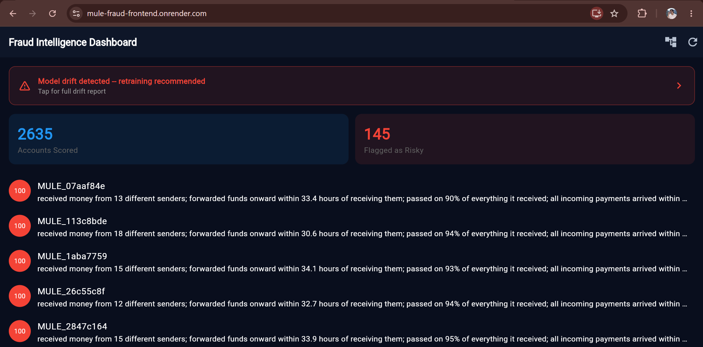
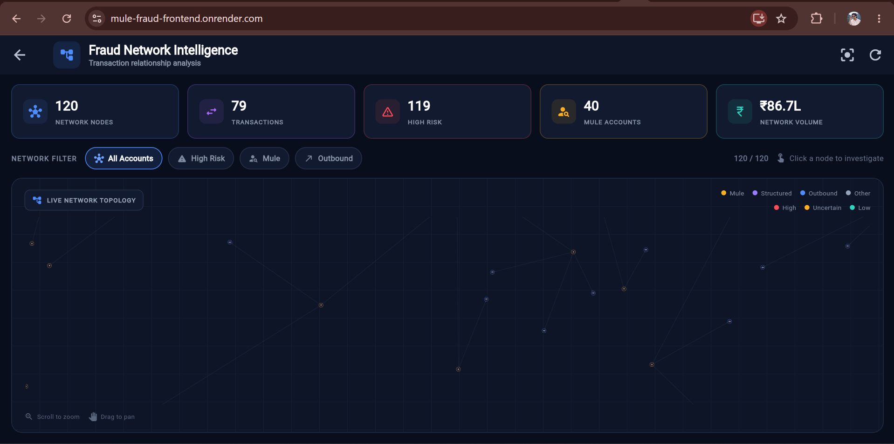
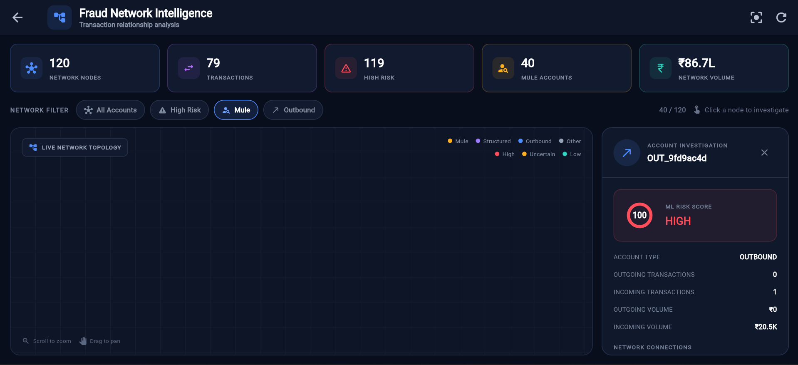
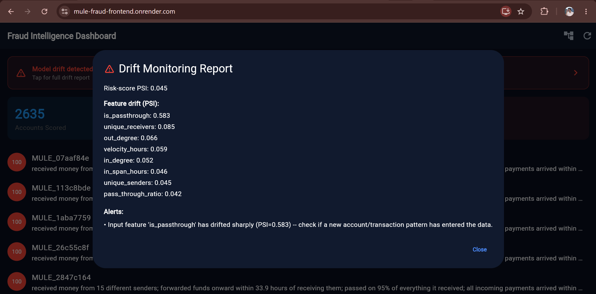

# 🛡️ MuleShield

### AI-Powered Mule Fraud Detection & Transaction Network Intelligence

*Detect suspicious accounts. Trace the network. Explain the risk. Monitor when fraud behavior changes — and prove that fixing it actually works.*

MuleShield is an end-to-end fraud intelligence platform that identifies suspicious mule accounts by combining **GraphSAGE-based graph learning**, **transaction-network analysis**, **behavioral explainability**, **model-drift monitoring**, and **adversarial robustness testing** into an investigator-oriented dashboard.

The goal isn't just to predict whether an account is fraudulent — it's to show investigators *why*, show them the surrounding network, and monitor when the underlying behavior changes.

---

## 🚀 Quick Links

| Component | Link |
|---|---|
| 🌐 Frontend (Flutter Web dashboard) | https://mule-fraud-frontend.onrender.com |
| 🤖 ML Service (FastAPI) | https://mule-fraud-ml.onrender.com |
| ☕ Backend (Spring Boot API) | https://mule-fraud-backend.onrender.com |
| 💻 Source Code | https://github.com/lakshaygaba18/mule-fraud-detection |

ML service health check:

```json
GET https://mule-fraud-ml.onrender.com

{
  "service": "Fraud Detection ML Service",
  "status": "running",
  "mode": "production"
}
```

---

## 📸 Platform Screenshots

<table>
  <tr>
    <td align="center">
      
    </td>
    <td align="center">
      
    </td>
  </tr>
  <tr>
    <td align="center"><b>Fraud Intelligence Dashboard</b></td>
    <td align="center"><b>Transaction Network Intelligence</b></td>
  </tr>
  <tr>
    <td align="center">
      
    </td>
    <td align="center">
      
    </td>
  </tr>
  <tr>
    <td align="center"><b>Account Investigation</b></td>
    <td align="center"><b>Model Drift Monitoring</b></td>
  </tr>
</table>

---

## 📊 Results & Key Findings

This is the core evidence for why this system is more than a classifier — it explores how a fraud detection system can identify its own blind spots, adapt to changing patterns, and evaluate whether retraining improves detection.

| Scenario | What happened | Result |
|---|---|---|
| **New fraud pattern appears** (structuring — money spread across many smaller, slower transfers) | Model recall dropped while aggregate risk-score distribution remained apparently stable | Score-based drift monitoring alone missed the problem (PSI = 0.045) |
| **Topology-level monitoring added** (`is_passthrough`) | The same structuring batch was checked at the feature level | Detected a major shift (PSI = 0.583) |
| **Adversarial red-team test** | A pattern was engineered to evade the original single-in/single-out topology check | Original GNN v1 recall: **67.1%** |
| **Retraining experiment** | GNN v2 was retrained on baseline + structuring data, without exposure to the exact adversarial test pattern | GNN v2 recall on that batch: **100%** |

**Why this matters:** MuleShield explores the full fraud-model lifecycle:

**Detect → Monitor → Identify blind spots → Retrain → Evaluate**

It also demonstrates why monitoring only the final risk-score distribution can be insufficient when a new behavior affects only a subset of accounts.

*The v2 model was deliberately not hot-swapped into production without a complete validation and rollout process.*

---

## 🎯 Problem Statement

Traditional fraud detection systems often evaluate transactions or accounts independently. Mule accounts, however, frequently operate as part of a transaction network.

```text
Account A
    │
    ▼
Mule Account
    │
    ├──────────► Account C
    │
    └──────────► Account D
```

An account that receives money from multiple senders, quickly forwards it, has a high pass-through ratio, and connects other suspicious accounts may be easier to identify when viewed as part of a network rather than as an isolated transaction.

MuleShield combines account-level behavioral features with graph-based learning and network intelligence to provide that broader view.

---

## 💡 Core Idea

A traditional system answers:

**"Is this account suspicious?"**

MuleShield aims to answer:

**"Why is this account suspicious, who is it connected to, how is money moving through the network, and has the underlying behavior changed since the model was trained?"**

```text
Fraud Detection
      +
Network Intelligence
      +
Explainability
      +
Risk Propagation
      +
Adversarial Testing
      +
Drift Monitoring
```

---

## ✨ Key Features

- 🧠 Graph Neural Network fraud detection using **GraphSAGE**
- 🔗 Interactive transaction-network visualization
- 🚨 Account-level risk scoring with HIGH, UNCERTAIN and LOW categories
- 🕵️ Behavioral account analysis
- 🔍 Plain-language explanations for suspicious activity
- 📈 Feature and risk-score drift monitoring using **PSI**
- 📊 Jensen-Shannon divergence experiments for explanation-pattern analysis
- 🧪 Adversarial fraud-pattern simulation
- 🔄 Retraining experiments with before/after evaluation
- 🌐 Network-based risk propagation using an explicit business rule
- 📋 Investigator-oriented fraud dashboard
- 📝 Drift-event audit logging and retraining recommendations
- ⚙️ REST APIs for fraud reports, network information, drift reports and audit history
- 🔌 MCP server exposing investigation capabilities to AI assistants
- 🤖 Claude AI Investigator Skill for structured, evidence-based investigations
- ☁️ Independently deployed frontend, backend and ML services

---

## 🏗️ System Architecture

### Main Application

```text
                    ┌──────────────────────────┐
                    │       Flutter Web        │
                    │ Investigation Dashboard │
                    └────────────┬─────────────┘
                                 │ REST API
                                 ▼
                    ┌──────────────────────────┐
                    │       Spring Boot        │
                    │     Application API     │
                    └────────────┬─────────────┘
                                 │ REST
                                 ▼
                    ┌──────────────────────────┐
                    │         FastAPI          │
                    │        ML Service        │
                    └────────────┬─────────────┘
                                 │
                ┌────────────────┼────────────────┐
                ▼                ▼                ▼
         ┌────────────┐   ┌────────────┐   ┌──────────────┐
         │  GraphSAGE │   │    Drift   │   │Explainability│
         │     GNN    │   │ Monitoring │   │    Signals   │
         └────────────┘   └────────────┘   └──────────────┘
```

### AI Investigation Layer

```text
       Claude AI Assistant
                │
                ▼
       MuleShield Investigator
             Skill
                │
                ▼
          MCP Protocol
                │
                ▼
        MuleShield MCP Server
                │
       ┌────────┼─────────┐
       ▼        ▼         ▼
   Account   Transaction  Network
 Investigation  Tracing   Analysis
                │
                ▼
          Drift Report
```

The MCP investigation layer is a separate integration that reads the project's local account, feature and transaction datasets. It is not a replacement for the main Flutter/Spring Boot/FastAPI application.

---

## 🧩 System Components

### 1. Flutter Web Frontend

Investigator-facing interface providing:

- Fraud dashboard
- Risk-score visualization
- Account investigation
- Behavioral explanations
- Transaction-network graph
- Network filters
- Drift-monitoring alerts
- Audit-log visibility

### 2. Spring Boot Backend

The application/API layer between the frontend and ML service.

Responsibilities include:

- Exposing REST endpoints
- Calling the ML service
- Returning fraud predictions and network data
- Providing drift reports and audit logs
- Recording drift events and retraining recommendations

### 3. FastAPI ML Service

The ML service handles:

- Fraud prediction
- GraphSAGE inference
- Feature processing
- Explainability
- Network data generation
- Drift analysis

The ML service is independently deployable from the application backend.

---

## 🧠 Machine Learning Pipeline

Transaction-level data is transformed into account-level behavioral features.

| Feature | What it captures |
|---|---|
| `in_degree` | Number of incoming transaction relationships |
| `out_degree` | Number of outgoing transaction relationships |
| `unique_senders` | Number of distinct sending accounts |
| `unique_receivers` | Number of distinct receiving accounts |
| `pass_through_ratio` | How much received money is subsequently passed onward |
| `velocity_hours` | Timing and velocity of transaction activity |
| `in_span_hours` | Time span of incoming activity |
| `is_passthrough` | Whether an account is a strict single-in/single-out chain link; used for monitoring rather than model input |

---

## 🔗 Graph Neural Network

```text
Nodes    → Accounts
Edges    → Transactions
Features → Account behavioral statistics
```

GraphSAGE learns representations using an account's own behavioral features and information aggregated from its neighboring accounts.

```text
Account Features
       │
       ▼
 GraphSAGE Layer
       │
       ▼
     ReLU
       │
       ▼
 GraphSAGE Layer
       │
       ▼
 Fraud Probability
       │
       ▼
   Risk Score
```

---

## 🚨 Risk Classification

```text
Risk Score >= 70   → HIGH

40 <= Score < 70   → UNCERTAIN

Risk Score < 40    → LOW
```

The UNCERTAIN category provides an intermediate risk band for human review instead of forcing every account into a binary decision.

---

## 🔍 Explainability

Flagged accounts are accompanied by plain-language behavioral signals.

Example:

```text
Risk Score: 87.4

Why flagged:
- Received money from multiple senders
- Forwarded funds shortly after receiving them
- Passed through a high percentage of received funds
```

These signals help investigators understand the behavior behind a model prediction.

---

## 🕸️ Transaction Network Intelligence

The network view allows investigators to examine:

- Incoming and outgoing transactions
- Connected accounts
- Risk levels of neighboring accounts
- Aggregated payment relationships
- Potentially suspicious transaction paths

The graph provides network context that account-level scoring alone cannot show.

---

## 🔄 Risk Propagation

```text
High-Risk Account
        │
        ▼
Connected Account
        │
        ▼
Network Context
        │
        ▼
Additional Risk Signal
```

An account connected directly to an already high-risk account can receive an additional risk contribution through an explicit business rule layered on top of the model score.

This keeps the network-based risk adjustment separately inspectable rather than hiding it entirely inside model weights.

---

## 📈 Model Drift Monitoring

Fraud patterns can change over time.

MuleShield uses:

- **Population Stability Index (PSI)** to compare baseline and current distributions.
- **Jensen-Shannon divergence** in explanation-pattern drift experiments.

Example drift report:

```json
{
  "overall_status": "major_shift",
  "score_psi": 0.045,
  "feature_psi": {
    "is_passthrough": 0.583
  },
  "explanation_js_divergence": 0.0057
}
```

**Key finding:** The aggregate risk-score distribution remained relatively stable (PSI = 0.045), even though a new transaction pattern affected model detection. Feature-level monitoring detected a shift in `is_passthrough` (PSI = 0.583).

This demonstrates why monitoring only the final model-score distribution may miss important changes in underlying behavior.

---

## 🧪 Adversarial Robustness Testing

MuleShield includes experiments designed to test whether its fraud detectors can handle deliberately modified transaction patterns.

One experiment introduced a structuring pattern in which outbound transfers were split to evade the original single-in/single-out topology check.

```text
Normal Data
     │
     ▼
Adversarial Simulation
     │
     ▼
Feature Generation
     │
     ▼
Model Scoring
     │
     ▼
Robustness Evaluation
```

The experiment showed that the evasion attempt still produced a detectable signal at the final cash-out hop.

The `is_passthrough` feature showed a PSI of 0.975 in that experiment.

The GNN v2 retraining experiment also improved recall on the evaluated adversarial batch from 67.1% to 100%.

---

## 📝 Audit & Retraining Recommendations

When significant drift is detected, the backend records an audit entry containing information such as:

- Timestamp
- Model version
- Drift metrics
- Retraining recommendation
- Review status

A recommendation such as `RETRAIN RECOMMENDED` can be recorded with a `pending_review` status until a human analyst reviews it.

Retraining is treated as a controlled process rather than an automatic production model replacement.

---

## 🔌 MCP Server Integration

MuleShield includes a Model Context Protocol (MCP) server built using **FastMCP** and the Python MCP SDK.

It exposes fraud investigation functions as tools that compatible AI assistants can call.

### Available MCP Tools

| Tool | Description |
|---|---|
| `list_flagged_accounts` | Lists the highest-risk accounts, sorted by model risk score. |
| `investigate_account` | Returns risk score, behavioral statistics, transaction-derived evidence, reliability information and caveats. |
| `trace_transactions` | Traces incoming and outgoing transaction connections across multiple hops. |
| `get_network_graph` | Returns a local transaction network with risk levels and aggregated payment edges. |
| `get_drift_report` | Compares current simulated account data with baseline data using feature-level and score PSI. |

### Investigation Capabilities

The MCP server supports:

- Account-level investigation
- Inbound and outbound transaction tracing
- Multi-hop transaction connection analysis
- Local transaction-network inspection
- Risk-level identification of connected accounts
- Model-drift reporting

### Responsible AI Safeguards

The MCP layer includes safeguards to prevent unsupported conclusions:

- Hidden simulator ground-truth labels are not exposed to the AI agent.
- Risk scores are model predictions, not verified fraud findings.
- Account ID prefixes are not treated as evidence.
- Transaction paths are described as connected relationships, not proof that the same funds moved through every account.
- Truncated network and transaction results are identified.
- Drift reports include explicit limitations.

### Running the MCP Server

Install dependencies:

```bash
pip install -r requirements.txt
```

The following local CSV files are required in the project root:

```text
account_risk_report.csv
account_features.csv
transactions.csv
```

The drift report also requires:

```text
drift_account_risk_report.csv
drift_account_features.csv
```

Start the MCP server:

```bash
python -m mcp_server.server
```

The server uses FastMCP's standard input/output transport.

**Note:** The MCP server reads local project datasets. It does not independently connect to a live banking database.

---

## 🤖 Claude AI Investigator Skill

MuleShield includes a custom Claude Skill named:

**`muleshield-investigator`**

The Skill provides a structured investigation workflow for a human fraud analyst using MuleShield's MCP tools.

### Investigation Workflow

```text
User Investigation Request
          │
          ▼
Select Account
          │
          ▼
Investigate Account
          │
          ▼
Trace Inbound / Outbound Transactions
          │
          ▼
Inspect Transaction Network
          │
          ▼
Check Model Drift
          │
          ▼
Generate Investigation Report
```

### Investigation Report Structure

The Skill generates a structured report containing:

1. **Summary** — Account risk level and main reason for investigation.
2. **Evidence** — Specific transaction and behavioral statistics.
3. **Money Flow** — Incoming sources, outgoing destinations and timing.
4. **Network** — Neighborhood size, high-risk connected accounts and truncation status.
5. **Reliability and Limits** — Data source, model limitations and drift status.
6. **Suggested Next Steps** — Manual checks for a human analyst.

### Responsible AI Guidelines

The Skill explicitly instructs Claude to:

- Use only information returned by MuleShield tools.
- Never invent account IDs, scores, amounts or transaction dates.
- Disclose that the data is simulated.
- Never declare an account fraudulent based only on its model score.
- Distinguish connected transaction paths from proven movement of funds.
- Recommend human review rather than autonomous enforcement.
- Explain limitations when tools return incomplete or unavailable information.

The Skill is stored in:

```text
agent/
└── skills/
    └── muleshield-investigator/
        └── SKILL.md
```

This integration demonstrates how ML predictions, transaction-network analysis and drift monitoring can be exposed as tools and used by an AI assistant for structured investigation.

---

## 🧬 Elliptic Dataset Experiments

In addition to the simulated transaction environment used by the main application, MuleShield contains a separate research and experimentation area using the real Elliptic Bitcoin transaction dataset.

These experiments explore graph-based fraud detection, baseline model comparisons, feature behavior and model performance under changing transaction patterns.

### Experiment Areas

- Baseline machine learning model training
- Graph Neural Network experiments using GraphSAGE
- GNN v1 and v2 training experiments
- XGBoost ablation experiments
- Feature and prediction diagnostics
- Drift analysis across transaction subsets

Experiment scripts are organized separately:

```text
elliptic_experiments/
├── experiments.py
├── load_elliptic.py
├── train_elliptic_baseline.py
├── train_elliptic_gnn.py
├── train_elliptic_gnn_v2.py
├── ablation_xgb.py
├── diagnose_steps.py
└── drift_by_step.py
```

### Research Focus

The Elliptic experiments are used to investigate:

- How graph-based models perform on transaction networks.
- How model behavior changes across different transaction subsets.
- Whether feature-level drift can identify changes in fraud patterns.
- How baseline and retrained models behave under evaluation.

**Important:** These are separate research experiments. Their results should not be confused with the deployed simulated-data application or interpreted as production fraud-detection accuracy.

---

## 🧪 Automated Testing

MuleShield includes automated tests for its MCP investigation layer using **Pytest**.

The test suite currently contains 11 tests covering important investigation and data-integrity behaviors.

### Test Coverage

- Risk-level classification
- Unknown account handling
- Invalid transaction-tracing directions
- Known account investigation
- Hidden ground-truth label protection
- Reliability information and caveats
- Transaction tracing consistency
- Network graph consistency
- Drift-report limitations
- Expected MCP tool availability

### Running Tests

Install the development testing dependency:

```bash
pip install pytest
```

Run the test suite:

```bash
python -m pytest tests -q
```

Latest verified result:

```text
11 passed
```

The test suite helps validate the MCP investigation layer and its expected behavior.

---

## 📡 API Endpoints

| Endpoint | Returns |
|---|---|
| `GET /api/fraud-report` | Account-level fraud predictions and behavioral explanations |
| `GET /api/drift-report` | Overall drift status, score PSI, feature PSI, explanation divergence and alerts |
| `GET /api/network` | Network nodes, risk scores, risk levels, account types and transaction edges |
| `GET /api/audit-log` | Drift-related audit events and retraining recommendations |

---

## 🛠️ Technology Stack

| Layer | Technologies |
|---|---|
| Frontend | Flutter, Dart, Material UI, GraphView |
| Backend | Java, Spring Boot, Maven, REST |
| ML Service | Python, FastAPI, PyTorch, PyTorch Geometric, GraphSAGE |
| Data Processing | Pandas, NumPy, Scikit-learn, SciPy |
| AI Integration | Model Context Protocol, FastMCP, Claude Skills |
| Testing | Pytest |
| Deployment | GitHub, Render, Docker |

---

## 📁 Project Structure

```text
mule-fraud-detection/
│
├── backend/                       # Spring Boot application
│
├── frontend/                      # Flutter Web dashboard
│
├── mcp_server/                    # MCP server integration
│   ├── server.py                  # FastMCP tool definitions
│   ├── data.py                    # Investigation and data functions
│   └── test_client.py             # MCP client testing utility
│
├── agent/
│   └── skills/
│       └── muleshield-investigator/
│           └── SKILL.md           # Claude investigation workflow
│
├── elliptic_experiments/          # Elliptic dataset research
│
├── tests/
│   └── test_mcp.py                # MCP automated tests
│
├── screenshots/                   # Project screenshots
│
├── fastapi_app.py                 # FastAPI ML service entrypoint
├── drift_monitor.py               # Drift detection
├── risk_propagation.py            # Network-based risk adjustment
├── explain.py                     # Explainability functions
│
├── build_features.py              # Account feature generation
├── build_drift_features.py        # Drift dataset feature generation
├── build_adversarial_features.py  # Adversarial feature generation
│
├── train_baseline.py              # Baseline model training
├── train_gnn.py                   # GraphSAGE training
├── retrain_gnn_v2.py              # Second-version GNN training
│
├── simulate_data.py               # Transaction data simulation
├── simulate_drift_batch.py        # Drift batch simulation
├── simulate_adversarial_batch.py  # Adversarial batch simulation
│
├── run_drift_check.py             # Drift evaluation
├── run_adversarial_drift_check.py # Adversarial drift evaluation
│
├── score_current_batch.py         # Current batch scoring
├── score_adversarial_batch.py     # Adversarial batch scoring
├── score_adversarial_with_v2.py   # V2 adversarial scoring
│
├── requirements.txt
├── Procfile
├── README.md
└── .gitignore
```

Generated datasets, local model artifacts and environment-specific files are excluded from version control where appropriate.

---

## ⚙️ Local Setup

### Prerequisites

- Python 3.x
- Java 17+
- Maven
- Flutter SDK
- Git

### 1. ML Service

Create and activate a virtual environment:

```bash
python -m venv venv
```

Windows:

```cmd
venv\Scripts\activate
```

Install dependencies:

```bash
pip install -r requirements.txt
```

Start the FastAPI service:

```bash
uvicorn fastapi_app:app --host 0.0.0.0 --port 8000
```

Service:

```text
http://localhost:8000
```

### 2. Spring Boot Backend

```bash
cd backend
mvnw clean package -DskipTests
```

Run the application:

```bash
java -jar target/backend-0.0.1-SNAPSHOT.jar
```

Backend:

```text
http://localhost:8080
```

### 3. Flutter Frontend

```bash
cd frontend
flutter pub get
flutter run -d chrome
```

### 4. Configurable API Endpoint

Run the Flutter application against the local backend:

```bash
flutter run -d chrome --dart-define=API_BASE_URL=http://localhost:8080
```

Or configure it to use a deployed backend:

```bash
flutter run -d chrome --dart-define=API_BASE_URL=https://your-backend-url
```

### 5. MCP Server

From the project root, with the virtual environment activated:

```bash
python -m mcp_server.server
```

Ensure the required local CSV datasets are present before starting the server.

### 6. Automated Tests

Install pytest:

```bash
pip install pytest
```

Run:

```bash
python -m pytest tests -q
```

---

## 🐳 Docker Deployment

Example Spring Boot backend Dockerfile:

```dockerfile
FROM eclipse-temurin:17-jdk

WORKDIR /app

COPY . .

RUN chmod +x mvnw
RUN ./mvnw clean package -DskipTests

EXPOSE 8080

CMD ["java", "-jar", "target/backend-0.0.1-SNAPSHOT.jar"]
```

The ML service and Spring Boot backend are deployed as independent services, keeping ML development decoupled from the application layer.

---

## 🔄 Future Improvements


- Real-time transaction-stream processing with rolling-window drift checks.
- Automated model retraining pipeline with validation and approval.
- Investigator case-management workflow.
- Human-in-the-loop feedback for model improvement.
- Production database integration.
- Expanded monitoring and model-performance evaluation.
- More extensive MCP integration and investigation workflows.

---

## 📸 Screenshots

**Fraud Intelligence Dashboard** — live drift alert banner, account list sorted by risk score, with plain-language reasons for every flag.


**Transaction Network Graph** — interactive, filterable (All / High Risk / Mule / Outbound) live topology of the account graph.


**Account Investigation Panel** — click any node to see its risk score, account type, transaction volumes, and network connections.


**Drift Monitoring Report** — per-feature PSI breakdown, showing `is_passthrough` catching a shift that the aggregate risk-score PSI missed.


---

## 📌 Disclaimer

This project is a technical demonstration and research-oriented fraud intelligence platform. It is not intended to make autonomous real-world financial decisions without appropriate validation, governance, human review, regulatory controls, and production-grade security.

---

**MuleShield** — Built with Flutter • Java • Spring Boot • Python • FastAPI • PyTorch Geometric • GraphSAGE • MCP • Claude Skills • Docker • Render
